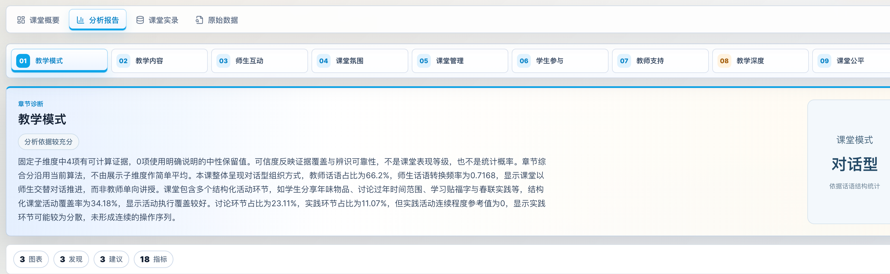

# Classroom Video Insights

**课堂视频复盘与证据分析**

面向教师和教研人员，将课堂视频整理成结构化记录、分析指标和复盘报告，便于查看教学过程、阅读图表和定位证据片段。

仓库通过截图和录屏展示平台功能；独立编写的代码示例使用合成数据，覆盖证据聚合、显示转换与验证。

## 功能预览

*教学模式分析：结合章节诊断、课堂模式和证据数量阅读报告。*

[查看五张功能截图](assets/screenshots/README.md) · [观看28秒报告浏览录屏](assets/demo/product-walkthrough.mp4)

报告包含课堂概况、章节诊断、Rt–Ch话语模式图、师生话语分布和指标解释。

## 项目参与

**项目职责**

主要参与Python后端、模型接入、分析流程联调及结构化结果交付，承担相关测试和部署排查工作。

**公开代码**

提供证据聚合、评价状态转换和输入输出串联的可运行示例。

[职责与代码入口](docs/contributions.md)

## 架构

~~~text
课堂视频 → Step1 预处理 / ASR → 结构化输入
         → Step2 指标与模型分析 → 一致性校验 → 报告 / 图表 / 证据
~~~

平台使用React、Vite、ECharts、Python和FastAPI，ASR与语言模型通过外部服务接入。任务状态与产物索引持久化，前端按阶段展示进度和结果。详见[架构说明](docs/architecture.md)。

## 代表实现与工程案例

- **[证据与评分一致性](docs/case-studies/evidence-aware-scoring.md)**：缺失项退出加权，可靠零值保留；部分可评价时缩小分母并说明范围。
- **[异步视频处理](docs/case-studies/asynchronous-video-processing.md)**：任务状态独立于页面连接，区分阶段完成、执行失败与指标待确认。
- **[部署与数据保全](docs/case-studies/deployment-and-data-preservation.md)**：核对实际运行来源、存储权限和历史数据，用状态、哈希与接口检查迁移结果。

## 运行方式

需要 **Python 3.10+、Node.js 22+**，无需安装Python或npm依赖。从仓库根目录运行：

~~~sh
python3 scripts/run-demo.py
~~~

命令读取[合成输入](samples/report/signals.synthetic.json)，生成[结果JSON](samples/report/report.sample.json)，并在终端显示四种结果：**85、待确认、80（部分可评价）、0**。

也可单独运行显示转换：

~~~sh
node examples/report-display/print-report.mjs samples/report/report.sample.json
~~~

[字段与兼容规则](examples/README.md) · [测试命令与覆盖范围](docs/validation.md)

## 验证与来源

38项行为测试覆盖聚合、显示、旧数据兼容和内容检查；[验证记录](docs/validation.md)单列平台历史测试，[性能记录](docs/performance.md)说明两个历史任务的计时口径。

[适用范围](docs/limitations.md) · [素材来源与第三方说明](THIRD_PARTY_NOTICES.md) · [许可与分发范围](docs/license-review.md)
