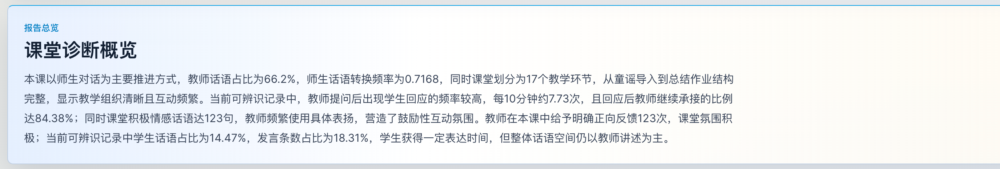
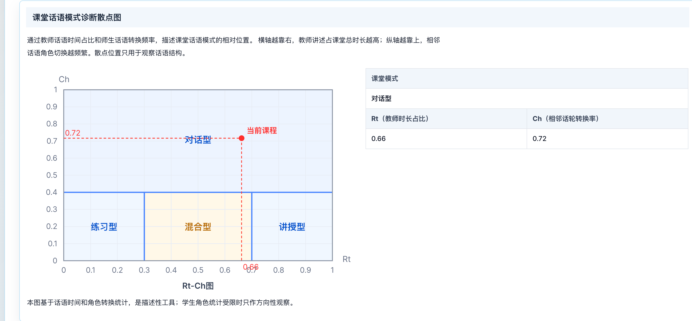
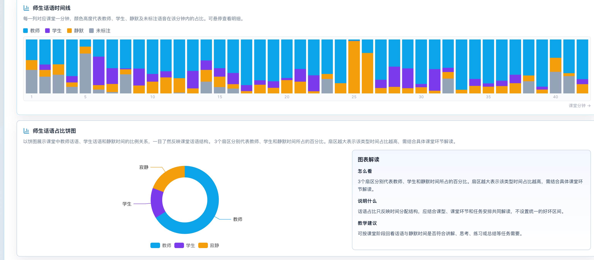
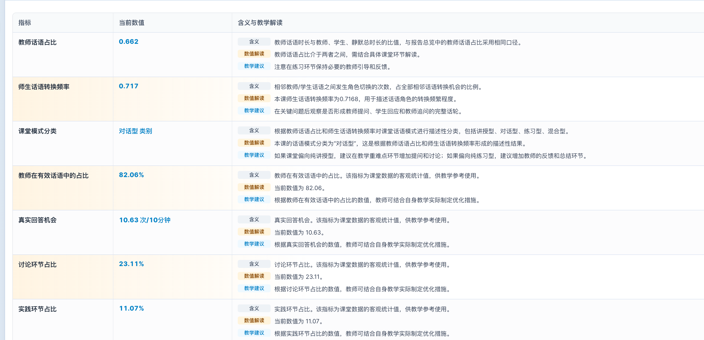

# 功能截图

| 图片 | 功能 |
| --- | --- |
| [报告总览](report-overview.png) | 汇总课堂诊断与主要指标 |
| [教学模式](teaching-mode.png) | 阅读章节诊断、课堂模式和证据数量 |
| [Rt–Ch图](rt-ch-chart.png) | 查看话语模式及对应数值 |
| [话语分布](speech-distribution.png) | 对照师生话语时间线与时长占比 |
| [指标说明](metric-details.png) | 阅读指标数值、含义与教学解释 |

[素材来源与第三方说明](../../THIRD_PARTY_NOTICES.md)
